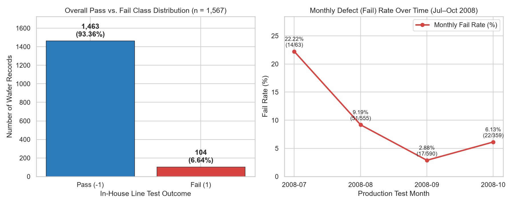
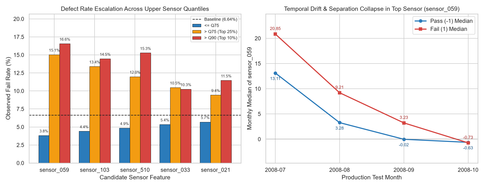
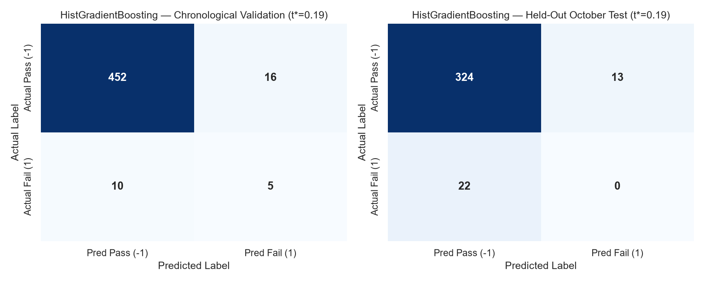
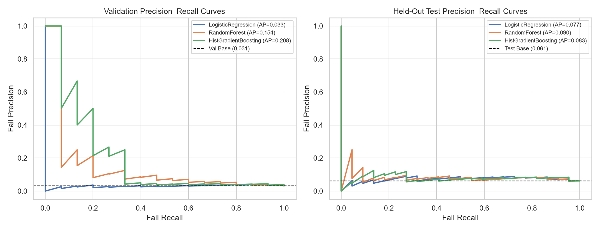
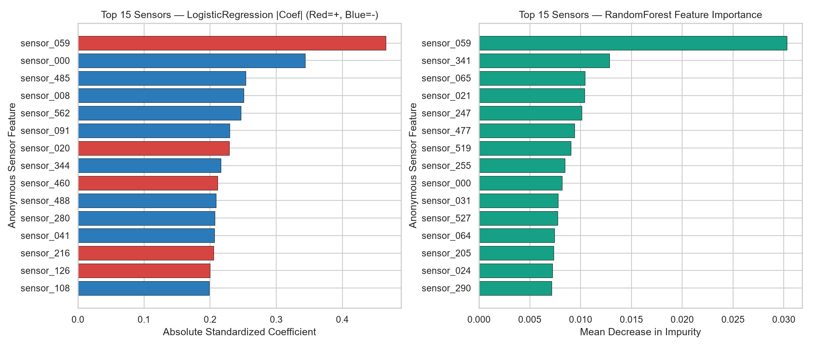

# Smart Manufacturing: Intelligent Process Quality Analysis and Predictive Defect Detection Using Machine Learning

**Final Academic Project Report (UCI SECOM Case Study)**  
**Repository:** `https://github.com/guhan-star/smart-manufacturing-predictive-quality-analytics`

---

## 1. Abstract
Semiconductor fabrication lines generate hundreds of high-dimensional process measurements per wafer, yet inline testing yields relatively rare defect events alongside substantial missingness and operational drift. This project designs, validates, and delivers an end-to-end, leakage-free machine learning and interactive analytics system on the official UCI SECOM dataset (`1,567` wafer records, `590` anonymous raw sensor measurements, `104` Fail / `6.64%` and `1,463` Pass / `93.36%`). Across four structured phases, we implement strict SHA-256 dataset verification, an unsupervised training-only cleaning pipeline (`440` active sensors retained on full EDA; `444` inside chronological training), Benjamini–Hochberg false-discovery-rate (BH-FDR) testing with observed-only sensitivity checks, timestamp-group-intact chronological Train (`725`) / Validation (`483`) / Test (`359`) splitting, and comparative evaluation of `Dummy_Majority`, `LogisticRegression`, `RandomForest`, and `HistGradientBoosting` classifiers wrapped in a Streamlit decision-support dashboard (`app.py`). Under strict validation-only selection, `HistGradientBoosting` achieved the highest chronological validation PR-AUC (`0.2080`, `6.7×` over the `0.0311` validation base rate; `33.33%` recall and `23.81%` precision at `t* = 0.19`). However, when evaluated once on the untouched October 2008 holdout set (`6.13%` fail rate), ranking remained above baseline (`PR-AUC = 0.0828`, `ROC-AUC = 0.5968`), while covariate drift across months pushed predicted failure probabilities below `t* = 0.19`, yielding `0 / 22` detected failures (`TP = 0, FP = 13`). These findings demonstrate both the viability of sensor-based risk ranking and the critical necessity of rolling retraining and adaptive threshold calibration under non-stationary manufacturing regimes.

---

## 2. Introduction
Modern semiconductor wafer manufacturing monitors hundreds of process tools, chambers, and inline metrology checkpoints. Detecting defective wafers early improves yield, lowers scrap cost, and prioritizes engineering diagnostics. However, industrial sensor logs present severe analytical hazards: extreme class imbalance, missingness driven by tool/logging schedule changes rather than random dropout, collinear redundant channels, and temporal process drift. Evaluating classifiers with random train/test splits or full-dataset preprocessing masks these hazards and produces overly optimistic performance estimates that fail when deployed forward in time.

---

## 3. Problem Statement
Given noisy, sparse, high-dimensional, and temporally drifting sensor readings recorded from an industrial semiconductor line, build a reproducible, leakage-safe predictive quality analytics pipeline that:
1. Audits and prepares raw sensor measurements without introducing target or future-to-past leakage.
2. Evaluates candidate models under realistic chronological constraints rather than optimistic random splits.
3. Surfaces verified EDA, model performance, explainability, and live CSV wafer-scoring through a lightweight interactive dashboard.

---

## 4. Research Objectives
1. Retrieve and verify the official UCI SECOM dataset (`ID 179`) using deterministic checksum validation and construct a complete field dictionary.
2. Perform strict schema validation, non-destructive outlier auditing, missing-value analysis, BH-FDR hypothesis testing, and observed-only vs. imputed sensitivity checks.
3. Build a leakage-free chronological Train/Validation/Test modeling pipeline comparing a majority baseline against interpretable linear (`LogisticRegression`) and tree-based (`RandomForest`, `HistGradientBoosting`) classifiers using PR-AUC, F2, and failure recall.
4. Deliver a verified, cached Streamlit dashboard (`app.py`) supporting interactive CSV risk scoring with strict input validation and transparent reporting of limitations.

---

## 5. Research Questions
- **RQ1:** Can inline semiconductor process sensor measurements predict wafer Pass/Fail quality outcomes better than chance and majority-class baselines under strict chronological validation?
- **RQ2:** Which anonymous sensor measurements exhibit statistically robust associations with failure outcomes after multiple-testing correction, and how stable are those signals across production months?
- **RQ3:** How does temporal non-stationarity affect fixed decision thresholds tuned on historical validation windows when applied prospectively to future production?

---

## 6. Dataset Description and Source
- **Source:** UCI Machine Learning Repository, SECOM Dataset (`https://archive.ics.uci.edu/dataset/179/secom`, `doi:10.24432/C54305`), retrieved programmatically via `src/secom_project/download_data.py`.
- **Dimensions:** `1,567` wafer instances aligned 1:1 across `secom.data` (`590` continuous anonymous sensor signals, `sensor_000`–`sensor_589`) and `secom_labels.data` (`target_label`, `timestamp_raw`). *(Note: UCI metadata lists 591 attributes; empirical inspection verifies 590 sensor columns plus timestamp/label.)*
- **Target Encoding Verification:** `secom.names` line 46 contains an ASCII glitch (`".1"`), whereas UCI API metadata (`"–1"`) and the documented fail count (`"104 fails"`) verify **`-1` = Pass (`1,463`, `93.3631%`)** and **`1` = Fail (`104`, `6.6369%`)**, an imbalance ratio of **`14.07 : 1`**.
- **Chronological Metadata:** All `1,567` timestamps parse under `%d/%m/%Y %H:%M:%S` spanning `2008-07-19 11:55:00` to `2008-10-17 06:07:00` (`89.76` days), monotonically non-decreasing in file order with `32` repeated-timestamp groups (`65` rows, `3` with conflicting labels).

---

## 7. Data Validation and Cleaning
Implemented in [data_validation.py](file:///e:/anti%20gravity/DSE/src/secom_project/data_validation.py) and [data_cleaning.py](file:///e:/anti%20gravity/DSE/src/secom_project/data_cleaning.py):
- **Strict Validation:** Rejects missing manifests, missing raw files, SHA-256 mismatches, row misalignment, unexpected column counts, `±inf` corruption, invalid/missing targets, and unparseable timestamps.
- **Duplicate Verification:** `0` duplicate sensor or full rows; `7` duplicate-column groups verified by hash pre-filter + exact NaN-mask and value equality (all among constant columns; `0` non-constant duplicate columns).
- **Missingness & Feature Removal (`150` of `590` removed, zero overlap):**
  - Raw missingness: `41,951 / 924,530` cells (`4.5375%`); `538 / 590` features and **`1,567 / 1,567` (`100%`) records** contain at least one `NaN` (`0.68%`–`25.76%`, median `4.07%`). Consequently, **`0` records were deleted**.
  - Removed **`116`** strictly constant features (`nunique <= 1`), **`6`** near-constant features (`>= 99%` dominant `0.0`; all non-zero variance came from a single Pass wafer `row 1458` at `2008-10-11 07:39:00`), and **`28`** extreme-missingness features (`> 50%` missing, `50.67%`–`91.19%`), retaining **`440`** active sensors in `data/processed/secom_cleaned.csv`.
- **Non-Destructive Outlier Audit:** `3.52%` of active cells exceed `1.5 × IQR` and `1.25%` (`1,392` records) exceed `3.0 × IQR`; **`0` outliers were removed** because sensor excursions may represent genuine defect precursors.

---

## 8. Exploratory Data Analysis
Key observations from [phase2_statistical_analysis.md](file:///e:/anti%20gravity/DSE/reports/phase2_statistical_analysis.md):
- **Heavy Skewness & Dispersion:** `245 / 440` (`55.7%`) cleaned sensors have `|skewness| > 2`, and `111` (`25.2%`) exceed `|skewness| > 10`; `122` sensors have `|std / mean| > 1.0`.
- **Collinearity:** Out of `96,580` sensor pairs, `112` have `|Pearson r| >= 0.99` (e.g., `sensor_034`/`sensor_036` at `r = -1.000`, `sensor_140`/`sensor_275` at `r = +1.000`) and `565` exceed `|r| >= 0.80`.
- **Monthly Yield Drift:** Defect rates decline nearly `8×` from July to September before rebounding in October:

| Month | Total Wafers | Fail Count | Fail Rate (%) | `sensor_059` Pass Med | `sensor_059` Fail Med | `sensor_072` Missing (%) |
|---|---:|---:|---:|---:|---:|---:|
| `2008-07` | 63 | 14 | 22.22% | 13.114 | 20.852 | 15.87% |
| `2008-08` | 555 | 51 | 9.19% | 3.278 | 9.208 | 32.25% |
| `2008-09` | 590 | 17 | 2.88% | -0.024 | 3.227 | 62.03% |
| `2008-10` | 359 | 22 | 6.13% | -0.630 | -0.730 | 66.57% |

---

## 9. Statistical Analysis
- **Multiple-Testing Correction (Benjamini–Hochberg FDR):** Across `440` two-sided Mann–Whitney U tests on median-imputed sensors, `86` features achieved raw `p < 0.05`, while **`25`** remained significant under BH-FDR (`q < 0.05`).
- **Observed-Only Sensitivity Analysis:** Repeating all `440` tests strictly on non-imputed raw observations yielded `86` raw `p < 0.05` and **`20`** BH-FDR `q < 0.05`, identifying `5` features (`sensor_112`, `sensor_122`, `sensor_298`, `sensor_431`, `sensor_452`) whose FDR significance shifted due to imputation. Most notably, `sensor_112` (`45.63%` missing; `n_pass=781, n_fail=71`) was *not* FDR-significant on observed values (`q = 0.0938`) but crossed `q = 0.0493` after median imputation injected `682` identical Pass medians vs. `33` Fail medians.
- **Top Candidate Associations (Non-Causal):** `sensor_059` (`r = +0.1560`, `rho = +0.1659`, `MW p = 5.18e-11`), `sensor_103` (`r = +0.1512`, `rho = +0.1451`, `p = 9.43e-09`), and `sensor_510` (`r = +0.1317`, `rho = +0.1174`, `p = 3.42e-06`).

---

## 10. Feature Selection and Preprocessing
To guarantee zero test-set or target leakage in Phase 3, `SecomTrainingPreprocessor` ([transformers.py](file:///e:/anti%20gravity/DSE/src/secom_project/transformers.py)) wraps Phase 2's `fit_cleaning_plan()` inside every scikit-learn `Pipeline`, ignoring `target_label` during `.fit()`. On the `725`-row chronological `Train` partition, `146` features (constant, near-constant, and `>50%` missing in `Train`) were removed and **`444`** active sensors were retained with training-fold median imputation (and `StandardScaler` for `LogisticRegression`). Raw `timestamp` and `target_label` are strictly excluded from model predictors.

---

## 11. Experimental Methodology & 12. Temporal Validation Strategy
Because process distributions and defect rates vary sharply across months, random train/test splitting would leak adjacent runs across time. Using [`build_train_val_test_splits`](file:///e:/anti%20gravity/DSE/src/secom_project/validation.py#L179-L237), records were ordered chronologically while keeping all `32` repeated-timestamp groups strictly intact:
- **Train (`2008-07-19 11:55` → `2008-09-04 08:41`):** `725` records (`658` Pass, `67` Fail / `9.24%`)
- **Validation (`2008-09-04 08:53` → `2008-09-30 23:58`):** `483` records (`468` Pass, `15` Fail / `3.11%`)
- **Held-Out Test (`2008-10-01 00:20` → `2008-10-17 06:07`):** `359` records (`337` Pass, `22` Fail / `6.13%`)

Model selection (by Validation PR-AUC) and decision threshold tuning (maximizing Validation `F2` within a `1%–40%` flag rate) used **Validation predictions only**. The held-out October test set was evaluated strictly once.

---

## 13. Model Comparison & 14. Results and Evaluation Metrics

| Model | Val `t*` | Val PR-AUC | Val ROC-AUC | Val Prec | Val Rec | Val F1 | Val F2 | Test PR-AUC | Test ROC-AUC | Test Prec | Test Rec | Test F1 | Test F2 |
|---|---:|---:|---:|---:|---:|---:|---:|---:|---:|---:|---:|---:|---:|
| `Dummy_Majority` | 0.50 | 0.0311 | 0.5000 | 0.0000 | 0.0000 | 0.0000 | 0.0000 | 0.0613 | 0.5000 | 0.0000 | 0.0000 | 0.0000 | 0.0000 |
| `LogisticRegression` | 0.64 | 0.0333 | 0.5236 | 0.0319 | 0.4000 | 0.0591 | 0.1210 | 0.0775 | 0.5979 | 0.0805 | 0.3182 | 0.1284 | 0.2000 |
| `RandomForest` | 0.22 | 0.1537 | 0.7091 | 0.1111 | 0.3333 | 0.1667 | 0.2381 | 0.0901 | 0.5943 | 0.0833 | 0.1818 | 0.1143 | 0.1471 |
| `HistGradientBoosting` | 0.19 | 0.2080 | 0.6610 | 0.2381 | 0.3333 | 0.2778 | 0.3086 | 0.0828 | 0.5968 | 0.0000 | 0.0000 | 0.0000 | 0.0000 |

- **Selected Model (`HistGradientBoosting`, `t* = 0.19`):**
  - **Validation (`n=483`, `15` fails):** `PR-AUC = 0.2080` (`6.7×` base rate), `Precision = 0.2381` (`5/21`), `Recall = 0.3333` (`5/15`), `F2 = 0.3086`.
  - **Held-Out October Test (`n=359`, `22` fails):** `PR-AUC = 0.0828`, `ROC-AUC = 0.5968`, `Accuracy = 0.9025`, `MCC = -0.0495`, `Confusion Matrix: TN=324, FP=13, FN=22, TP=0`.

---

## 15. Major Findings
1. **Severe Temporal Drift Breaks Static Thresholds:** `HistGradientBoosting` achieved strong validation enrichment (`0.2080` PR-AUC) and maintained above-baseline probability ranking on October (`0.0828` PR-AUC, `0.5968` ROC-AUC), yet **detected `0 / 22` October failures at fixed `t* = 0.19`** because October covariate drift shifted its predicted probabilities downward below `0.19` (while `LogisticRegression` and `RandomForest` retained `31.82%` and `18.18%` test recall at their validation thresholds).
2. **Non-Stationary Dominant Signal (`sensor_059`):** `sensor_059` ranked `#1` in both `LogisticRegression` (`+0.4655`) and `RandomForest` (`0.03029`), yet its Pass median drifted monotonically from `13.114` (Jul) to `-0.630` (Oct), losing separation by October.
3. **Non-MCAR Imputation Sensitivity:** Missingness patterns correlate with monthly logging changes (`sensor_072` missingness `15.87%` → `66.57%`), distorting imputed hypothesis ranks when unaccounted for.

---

## 16. Limitations
1. **Small Positive Sample Size:** `104` total failures (`67` Train, `15` Validation, `22` Test) yield high metric variance and unstable fixed thresholds.
2. **Anonymous Signals & Lack of Causal Metadata:** Without physical sensor names, units, or process-step timestamps, feature rankings (`sensor_059`, `sensor_000`, `sensor_021`) represent statistical associations, **not** physical root causes.
3. **Static Model Decay:** A model trained on July–early September degrades over a 4–6 week forward horizon without retraining.

---

## 17. Recommendations
1. **Rolling-Window Retraining:** Retrain classifiers on sliding recent production windows (e.g., 30–45 days) to adapt to tool drift and recipe updates.
2. **Adaptive Threshold & Drift Monitoring:** Trigger threshold recalibration and Statistical Process Control (SPC) alerts whenever flagged-wafer rates drop abnormally or top-sensor distributions shift.
3. **Decision-Support Deployment Only:** Use the Streamlit dashboard (`app.py`) to prioritize metrology inspection queues, never for autonomous wafer scrapping without fab cost matrices and physical domain context.

---

## 18. Conclusion
This project delivers an end-to-end, reproducible, leakage-safe predictive quality analytics system for semiconductor manufacturing (`19/19` automated tests passing). While inline sensors carry genuine non-random defect signal, our chronological evaluation proves that temporal drift—not static model capacity—is the primary operational barrier, directly motivating adaptive monitoring in smart manufacturing.

---

## 19. References
1. McCann, M., & Johnston, A. (2008). *SECOM Data Set* [Data set]. UCI Machine Learning Repository. `https://archive.ics.uci.edu/dataset/179/secom`, `doi:10.24432/C54305`.
2. Benjamini, Y., & Hochberg, Y. (1995). Controlling the false discovery rate: a practical and powerful approach to multiple testing. *Journal of the Royal Statistical Society: Series B*, 57(1), 289–300.
3. Pedregosa, F., et al. (2011). Scikit-learn: Machine Learning in Python. *JMLR*, 12, 2825–2830.
