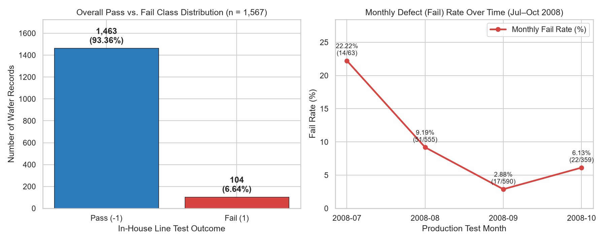
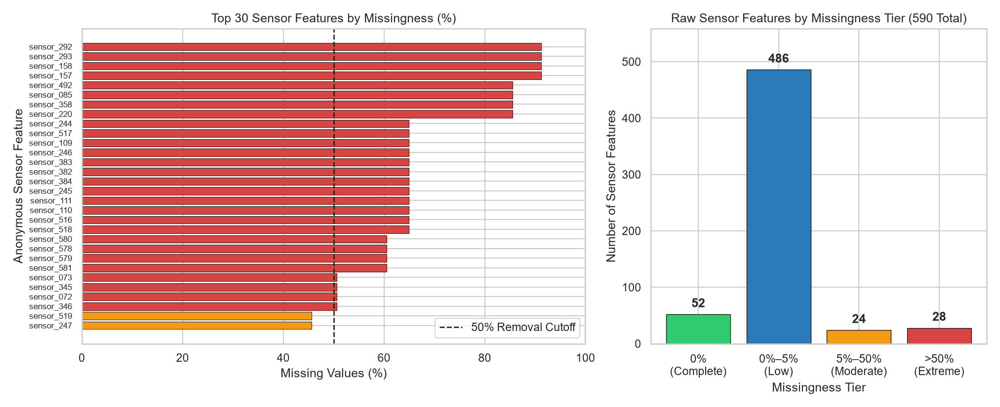
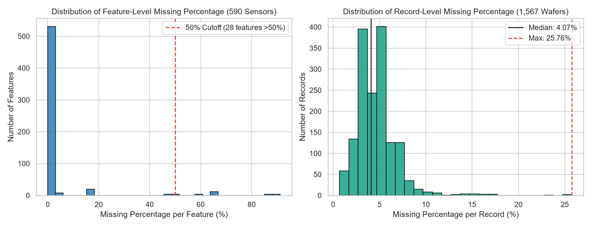
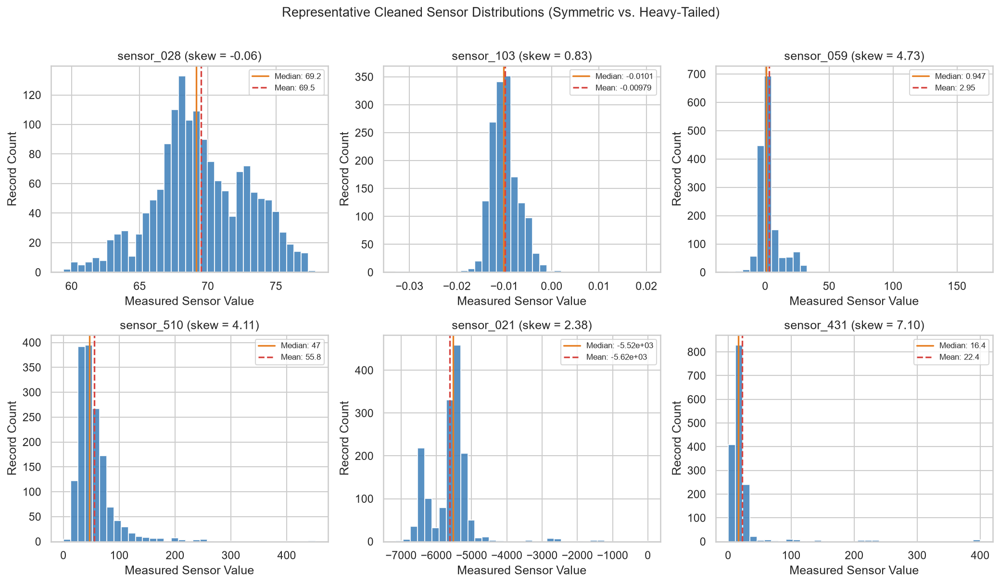
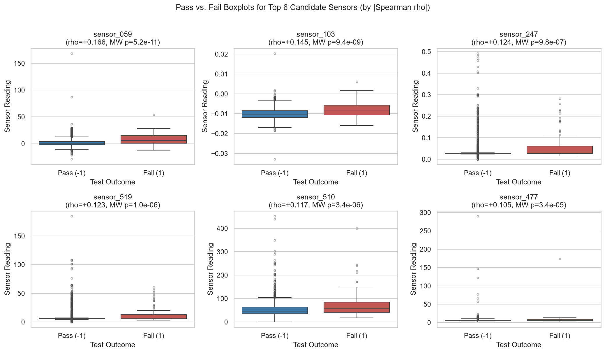
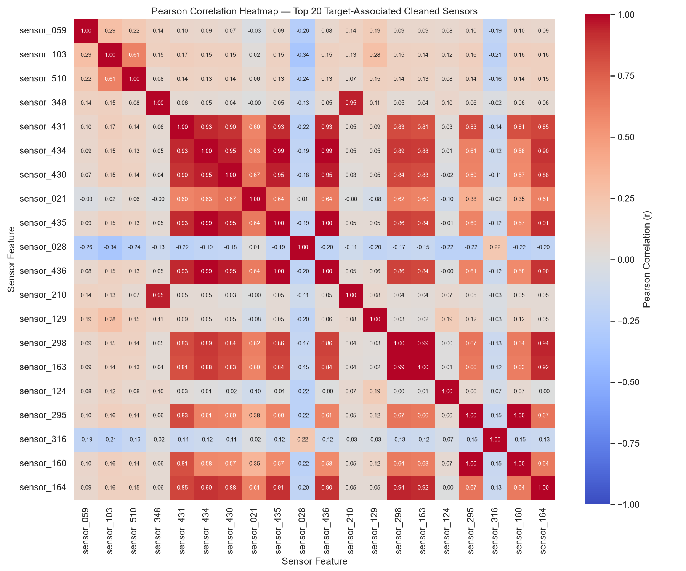
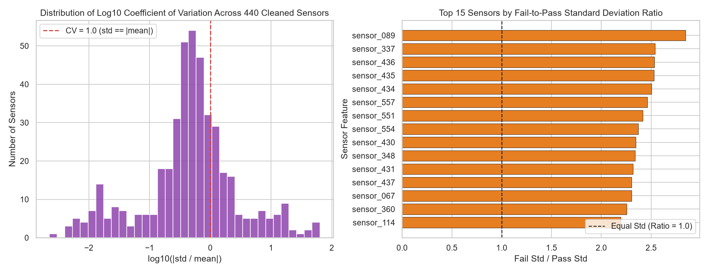
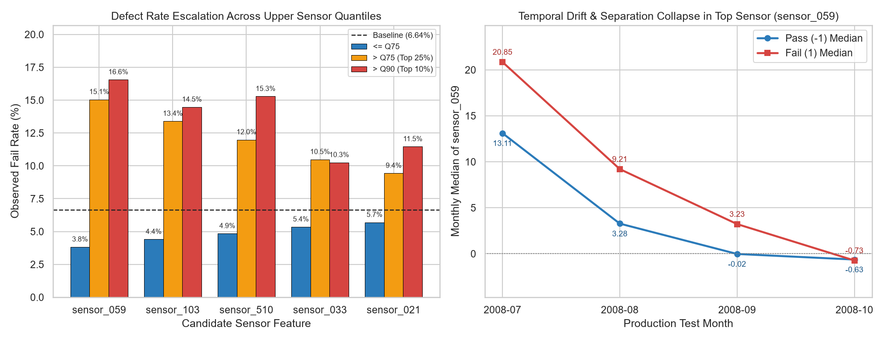

# Phase 2 Statistical Analysis & EDA Report — UCI SECOM

## 1. Overview & Descriptive Statistics (`reports/phase2_statistical_summary.csv`)
- **Dataset Scope:** `1567` records (`1463` Pass `-1` / `93.36%`, `104` Fail `1` / `6.64%`, **`14.07 : 1` class imbalance**) across `440` cleaned anonymous sensor features (`sensor_000`–`sensor_589` subset).
- **Metrics Computed for All 440 Cleaned Sensors:** `mean`, `median`, `mode` (with mode frequency & share), `std`, `variance`, `min`, `max`, `range`, `q25`, `q50`, `q75`, `iqr`, `skewness`, `kurtosis`, `raw_missing_count`, `raw_missing_pct`, and `n_unique_non_null_raw`.
- **Distribution Shape:** `245` / `440` sensors (`55.7%`) exhibit `|skewness| > 2` and `111` (`25.2%`) exceed `|skewness| > 10`. Because continuous floating-point readings rarely repeat identically unless quantized or median-imputed, mode is mainly informative on discrete/low-cardinality signals.

---

## 2. Feature Rankings (Missingness, Variance, Unique Values)

### 2A. Missingness Ranking (Top 15 of 590 Raw Features)
| Rank | Feature | Missing Count | Missing % | Phase 2 Action |
|---:|---|---:|---:|---|
| 1 | `sensor_157` | 1429 | 91.19% | Removed (High Missingness >50%) |
| 1 | `sensor_158` | 1429 | 91.19% | Removed (High Missingness >50%) |
| 1 | `sensor_292` | 1429 | 91.19% | Removed (High Missingness >50%) |
| 1 | `sensor_293` | 1429 | 91.19% | Removed (High Missingness >50%) |
| 5 | `sensor_085` | 1341 | 85.58% | Removed (High Missingness >50%) |
| 5 | `sensor_220` | 1341 | 85.58% | Removed (High Missingness >50%) |
| 5 | `sensor_358` | 1341 | 85.58% | Removed (High Missingness >50%) |
| 5 | `sensor_492` | 1341 | 85.58% | Removed (High Missingness >50%) |
| 9 | `sensor_109` | 1018 | 64.96% | Removed (High Missingness >50%) |
| 9 | `sensor_110` | 1018 | 64.96% | Removed (High Missingness >50%) |
| 9 | `sensor_111` | 1018 | 64.96% | Removed (High Missingness >50%) |
| 9 | `sensor_244` | 1018 | 64.96% | Removed (High Missingness >50%) |
| 9 | `sensor_245` | 1018 | 64.96% | Removed (High Missingness >50%) |
| 9 | `sensor_246` | 1018 | 64.96% | Removed (High Missingness >50%) |
| 9 | `sensor_382` | 1018 | 64.96% | Removed (High Missingness >50%) |

### 2B. Variance Ranking (Top 15 of 440 Cleaned Features)
*Note: Variance is scale-dependent (units are undisclosed in UCI SECOM); high raw variance reflects both physical signal scale and extreme tail excursions.*

| Rank | Feature | Variance | Std Dev | Range | Skewness |
|---:|---|---:|---:|---:|---:|
| 1 | `sensor_162` | 4.291e+07 | 6550 | 3.687e+04 | 1.83 |
| 2 | `sensor_161` | 1.795e+07 | 4237 | 3.794e+04 | 2.23 |
| 3 | `sensor_297` | 1.04e+07 | 3225 | 1.852e+04 | 1.79 |
| 4 | `sensor_024` | 8.415e+06 | 2901 | 2.891e+04 | -0.05 |
| 5 | `sensor_296` | 3.897e+06 | 1974 | 1.556e+04 | 2.19 |
| 6 | `sensor_023` | 1.902e+06 | 1379 | 1.235e+04 | 0.36 |
| 7 | `sensor_159` | 9.652e+05 | 982.5 | 7791 | 4.21 |
| 8 | `sensor_021` | 3.924e+05 | 626.4 | 7150 | 2.38 |
| 9 | `sensor_160` | 3.3e+05 | 574.5 | 4170 | 4.00 |
| 10 | `sensor_204` | 3.181e+05 | 564 | 9998 | 17.64 |
| 11 | `sensor_140` | 2.547e+05 | 504.7 | 9999 | 19.74 |
| 12 | `sensor_294` | 2.273e+05 | 476.8 | 3934 | 4.43 |
| 13 | `sensor_003` | 1.935e+05 | 439.8 | 3715 | 1.72 |
| 14 | `sensor_225` | 1.817e+05 | 426.3 | 3432 | 1.11 |
| 15 | `sensor_090` | 1.519e+05 | 389.8 | 3349 | 0.35 |

### 2C. Unique-Value Count Ranking (`n_unique_non_null_raw`)
**Highest Cardinality (Top 10 Continuous Signals):**

| Rank | Feature | Unique Values | Mode (Freq) |
|---:|---|---:|---|
| 1 | `sensor_115` | 1567 | 748.6 (1x) |
| 2 | `sensor_250` | 1566 | 90.24 (2x) |
| 3 | `sensor_296` | 1565 | 1202 (3x) |
| 4 | `sensor_460` | 1564 | 35.81 (2x) |
| 4 | `sensor_388` | 1564 | 28.04 (2x) |
| 6 | `sensor_423` | 1563 | 69.91 (3x) |
| 7 | `sensor_490` | 1562 | 66.01 (2x) |
| 7 | `sensor_294` | 1562 | 278.7 (3x) |
| 7 | `sensor_522` | 1562 | 12.24 (2x) |
| 7 | `sensor_046` | 1562 | 725.9 (2x) |

**Lowest Cardinality Among Retained Active Sensors (Bottom 10 Quantized / Discrete Signals):**

| Rank | Feature | Unique Values | Mode (Freq, %) |
|---:|---|---:|---|
| 440 | `sensor_521` | 9 | 0 (1546x, 98.7%) |
| 439 | `sensor_095` | 14 | 0 (683x, 43.6%) |
| 438 | `sensor_114` | 20 | 0 (1545x, 98.6%) |
| 437 | `sensor_544` | 21 | 0.0026 (823x, 52.5%) |
| 434 | `sensor_387` | 22 | 0 (1545x, 98.6%) |
| 434 | `sensor_094` | 22 | 0 (498x, 31.8%) |
| 434 | `sensor_278` | 22 | 0.0009 (246x, 15.7%) |
| 433 | `sensor_249` | 23 | 0 (1545x, 98.6%) |
| 432 | `sensor_357` | 28 | 0.0009 (216x, 13.8%) |
| 431 | `sensor_101` | 29 | 0 (462x, 29.5%) |

---

## 3. Pass vs. Fail Distribution Comparison & Methodology

Because `245` sensors are strongly skewed and class sizes are unbalanced (`1,463` vs `104`), **non-parametric Mann-Whitney U tests** and **Spearman rank correlation (`rho`)** are preferred alongside **Pearson `r`** and median/IQR comparisons (parametric normality assumptions of Student's t-test are violated for most sensors).

| Feature | Pearson `r` | Spearman `rho` | Raw MW `p` | BH-FDR `q` | FDR Sig (`q<0.05`) | Pass Median | Fail Median | Pass IQR | Fail IQR |
|---|---:|---:|---:|---:|:---:|---:|---:|---:|---:|
| `sensor_059` | +0.1560 | +0.1659 | 5.18e-11 | 2.28e-08 | Yes | 0.7482 | 5.5223 | 5.8532 | 14.4157 |
| `sensor_103` | +0.1512 | +0.1451 | 9.43e-09 | 2.08e-06 | Yes | -0.0102 | -0.0082 | 0.0035 | 0.0049 |
| `sensor_510` | +0.1317 | +0.1174 | 3.42e-06 | 3.01e-04 | Yes | 46.4122 | 58.2324 | 27.8671 | 44.1835 |
| `sensor_348` | +0.1308 | +0.0802 | 1.50e-03 | 3.51e-02 | Yes | 0.0226 | 0.0246 | 0.0089 | 0.0163 |
| `sensor_431` | +0.1199 | +0.0757 | 2.74e-03 | 4.93e-02 | Yes | 16.2134 | 18.3800 | 10.6790 | 10.1893 |
| `sensor_434` | +0.1113 | +0.0586 | 2.04e-02 | 1.66e-01 | No | 10.1575 | 11.3137 | 5.1799 | 5.3844 |
| `sensor_430` | +0.1091 | +0.0516 | 4.12e-02 | 2.29e-01 | No | 10.9889 | 13.2558 | 10.4337 | 10.7470 |
| `sensor_021` | +0.1083 | +0.0884 | 4.68e-04 | 1.42e-02 | Yes | -5528.7500 | -5447.5000 | 608.1250 | 365.1875 |
| `sensor_435` | +0.1083 | +0.0297 | 2.40e-01 | 5.93e-01 | No | 4.5274 | 4.7435 | 2.3079 | 2.5280 |
| `sensor_028` | -0.1070 | -0.1001 | 7.45e-05 | 3.64e-03 | Yes | 69.2444 | 68.1945 | 4.9000 | 3.9223 |

- **Multiple-Testing Summary (440 Tests):** `86` features have raw `p < 0.05`, whereas only **`25`** remain significant after **Benjamini–Hochberg FDR (`q < 0.05`)**. Across 440 simultaneous hypothesis tests, raw `p < 0.05` expects ~22 false discoveries by chance alone; BH-FDR controls the expected proportion of false discoveries among rejected hypotheses at 5%.

### Statistical Limitations & Assumptions
1. **Association ≠ Causation:** Statistical separation (`q < 0.05`) indicates correlation with test outcomes, not physical root cause; sensor definitions and upstream/downstream process order are undocumented.
2. **Class Imbalance Compression:** At `6.64%` Fail prevalence, linear Pearson point-biserial `r` is compressed (max `|r| = 0.1560`), even when tail failure rates multiply (`3.9×` above Q75 in `sensor_059`).
3. **Multiple Comparisons & Observed-Only Sensitivity:** Screening `440` features requires BH-FDR control (`25` FDR-significant on imputed data vs `20` on observed-only data; see `reports/phase2_observed_vs_imputed_sensitivity.csv` and `reports/phase2_final_review.md`).
4. **Imputation Effect:** Unsupervised median imputation preserves row count without target leakage, but compresses variance/IQR on moderately missing features (`sensor_247`, `sensor_519`, `sensor_112` at `45.63%` missing).

---

## 4. Sensor-to-Sensor Correlation & Collinearity
- **Unique Sensor Pairs Evaluated:** `96,580`
- **Pairs with `|Pearson r| >= 0.99`:** `112` (`>= 0.95`: `257`, `>= 0.90`: `332`, `>= 0.80`: `565`)
- **Pairs with `|Spearman rho| >= 0.90`:** `281`

| Feature A | Feature B | Pearson `r` |
|---|---|---:|
| `sensor_034` | `sensor_036` | -1.000000 |
| `sensor_140` | `sensor_275` | +1.000000 |
| `sensor_172` | `sensor_174` | +1.000000 |
| `sensor_307` | `sensor_309` | +0.999999 |
| `sensor_152` | `sensor_287` | +0.999997 |
| `sensor_252` | `sensor_390` | +0.999991 |
| `sensor_004` | `sensor_275` | +0.999976 |
| `sensor_004` | `sensor_140` | +0.999975 |
| `sensor_251` | `sensor_389` | +0.999939 |
| `sensor_249` | `sensor_387` | +0.999938 |

---

## 5. Key Temporal Process-Drift Discovery

| Month | Wafers | Fail Rate | `sensor_059` Pass Med | `sensor_059` Fail Med | `sensor_103` Pass Med | `sensor_103` Fail Med |
|---|---:|---:|---:|---:|---:|---:|
| 2008-07 | 63 | 22.22% | 13.114 | 20.852 | -0.0071 | -0.0058 |
| 2008-08 | 555 | 9.19% | 3.278 | 9.208 | -0.0085 | -0.0077 |
| 2008-09 | 590 | 2.88% | -0.024 | 3.227 | -0.0109 | -0.0116 |
| 2008-10 | 359 | 6.13% | -0.630 | -0.730 | -0.0111 | -0.0088 |

Across the 90-day timeline, monthly fail rates swing from `22.22%` (Jul) down to `2.88%` (Sep) and back to `6.13%` (Oct). Meanwhile, the strongest global candidate (`sensor_059`) drifts steadily downward (`13.114` → `-0.630`) and loses Pass/Fail median separation in October (`-0.630` vs `-0.730`), highlighting strong process non-stationarity.

---

## 6. Visualisations & Interpretations

### 1. Pass vs. Fail Class Distribution

**Interpretation:** The dataset exhibits a `14.07 : 1` imbalance (`1,463` Pass `93.36%` vs. `104` Fail `6.64%`), while monthly defect rates fluctuate sharply from `22.22%` in July 2008 to `2.88%` in September 2008 before rising to `6.13%` in October 2008. Accuracy alone is therefore uninformative, and evaluation must respect temporal non-stationarity.

### 2. Missingness Across Sensor Features

**Interpretation:** Sensor missingness clusters into discrete operational blocks; `28` sensors exceed the `50%` cutoff (`50.67%`–`91.19%` missing) and are separated by a clear gap from the `4` moderate-missingness sensors at `45.63%`, justifying the `>50%` feature-removal boundary.

### 3. Feature & Record Missing-Percentage Distributions

**Interpretation:** Most raw features (`538 / 590`) have `<= 5%` missing values, whereas every single wafer record (`1,567 / 1,567`) contains between `0.68%` and `25.76%` missing sensor values (median `4.07%`). Dropping incomplete records is therefore infeasible and unsupervised imputation is required.

### 4. Selected Sensor Distributions

**Interpretation:** Cleaned sensors span from near-symmetric (`sensor_028`, `skew = -0.06`) and mildly skewed (`sensor_103`, `skew = 0.83`) distributions to heavily right-skewed, tail-dominated signals (`sensor_059` `skew = 4.73`, `sensor_510` `skew = 4.11`, `sensor_431` `skew = 7.10`), motivating non-parametric tests and median imputation.

### 5. Pass vs. Fail Boxplot Comparison

**Interpretation:** Top Spearman-ranked sensors (`sensor_059`, `sensor_103`, `sensor_510`) show upward-shifted medians and wider upper tails in Fail wafers compared to Pass wafers. On `sensor_247` and `sensor_519` (`45.63%` missing), the Pass box collapses near the imputed median because Pass records had higher missingness (`46.62%` vs `31.73%`), illustrating why missingness regime differences require caution.

### 6. Correlation Heatmap (Top 20 Candidate Sensors)

**Interpretation:** Strong collinear blocks appear among target-associated features (e.g., `sensor_430`/`sensor_431`/`sensor_434`/`sensor_435`/`sensor_436` with `r >= 0.90`, `sensor_160`/`sensor_295` at `r = 1.00`, and `sensor_163`/`sensor_298` at `r = 0.99`), confirming substantial redundancy across anonymous monitoring channels.

### 7. Feature Variability Comparison

**Interpretation:** Relative dispersion varies by orders of magnitude across the `440` sensors (`122` with `|std / mean| > 1.0`), and several sensors exhibit more than double the standard deviation in Fail wafers compared to Pass wafers, suggesting variance/excursion sensitivity rather than pure mean shifts.

### 8. Pass-versus-Fail Quantile Escalation & Temporal Drift

**Interpretation:** Defect rates escalate markedly in the upper quantiles of top candidate sensors (e.g., `sensor_059` rises from `3.8%` below Q75 to `15.1%` above Q75 and `16.6%` above Q90), yet the right panel shows `sensor_059` drifting downward over time and losing separation in October 2008—demonstrating why static thresholds alone are insufficient.
